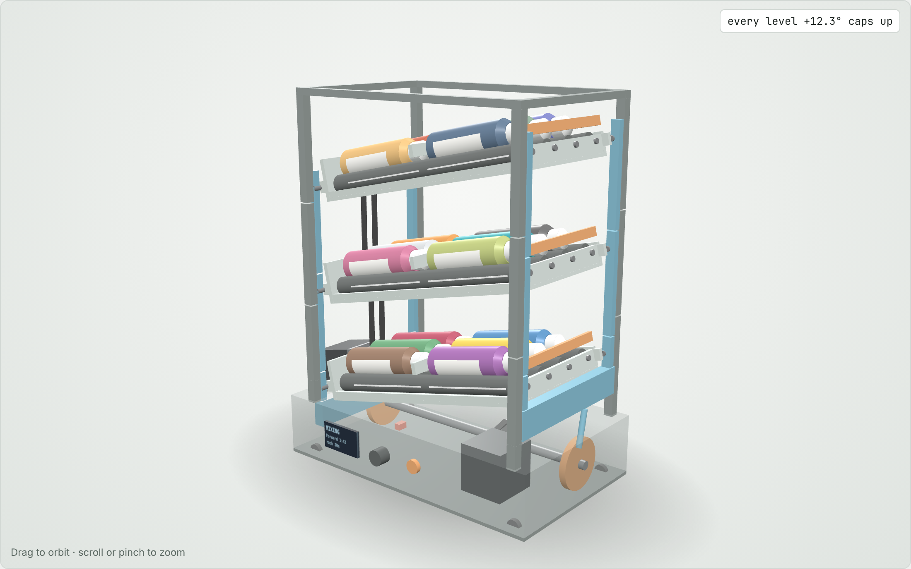

# Paint Bottle Roller

A modular, 3D-printed roller-rocker that keeps miniature paint mixed. It works like a lab tube roller-rocker: dropper bottles (Vallejo-style 17 ml) lie lengthwise on rollers that spin them, while the two ends of every deck rise and fall in opposition to rock the paint end to end. There is no centre pivot.



## Current design

- **Modular, up to 3 levels.** Start with a base plus 1 or 2 levels and add more later. Each level holds 6 bottles (3 valleys, 2 bottles end to end, caps toward the loading end), so the maximum is 18 bottles.
- **Load by hand.** Levels sit 90 mm apart, which leaves about 49 mm of hand room above the bottles. The front and cap end of every level are open. There are no drawers.
- **One roll motor on level 1** drives every level. A spare Ender 3 NEMA 17 turns roller 2 directly; O-rings link the rollers within a level and GT2 220 mm loops carry the drive up to the next level.
- **One rock motor in the base** turns a crankshaft with two cranks 180° apart. Four lifter bars carry every deck at its corners, so each end moves ±19 mm (about ±10°, with a +3° caps-up bias) and every level gets identical motion.
- **Footprint** 260 × 152 mm (about 296 mm long with the roll motor). Heights are about 149 / 239 / 329 mm for 1 / 2 / 3 levels.
- **Electronics:** ESP32 DevKitC, 2 × TMC2209 (UART, StealthChop for quiet running), 0.96" SSD1306 OLED, KY-040 encoder, MIX button, 12 V supply.

### Low-cost BOM

The main build reuses Ender 3 parts (both steppers, GT2 pulleys, endstop, screws) and bearings from stock, buys the rest on AliExpress and prints everything it can.

| Stack | Bottles | Approx. cost |
| --- | --- | --- |
| Base + 1 level | 6 | ~$73 |
| Base + 2 levels | 12 | ~$90 |
| Base + 3 levels | 18 | ~$107 |

The base kit is about $56 and each level about $17. The full BOM, the optional premium upgrades, printed parts, wiring, torque checks and assembly steps are in [docs/design.md](docs/design.md).

## Folder layout

```
docs/
  design.md                 Full design: dimensions, drive, rocking, torque, BOM, printed parts, wiring, assembly, tests
firmware/
  platformio.ini            PlatformIO build (env esp32dev)
  PaintRoller/
    PaintRoller.ino         ESP32 firmware (FastAccelStepper, TMCStepper, U8g2, optional Wi-Fi page)
render/
  paint-roller-3d.html      Interactive three.js concept model (open in a browser; 1/2/3 levels, views, motion)
  render-*.png              Stills of the 1, 2 and 3 level stacks
```

## Building the firmware

With PlatformIO: `cd firmware && pio run -t upload`. With the Arduino IDE: open `firmware/PaintRoller/PaintRoller.ino` and install FastAccelStepper, TMCStepper and U8g2 from the Library Manager. Build with `-D ENABLE_WIFI=0` to drop the Wi-Fi settings page.

## Status

Concept stage. The 3D model is built from the design dimensions, not CAD. The firmware has not been compiled yet, so expect a small fix or two on the first build. The bottle size (26 × 92 mm) is assumed and should be measured, because it sets the deck length.
