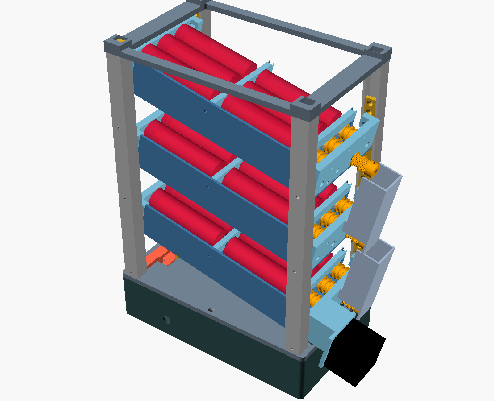

# Printed parts (CAD)

Parametric OpenSCAD models of every printed part, with STLs ready to slice.

- `paint_roller.scad`: all parts in one file. Parameters (bearing type, fits, bottle size) are at the top.
- `assembly.scad`: the whole stack for checking fits. Set `levels` (1 to 3) and `phi` (crank angle) at the top.
- `export.sh`: re-exports every STL into `stl/` after you change a parameter.
- `stl/`: the STLs, already turned onto the bed in their print orientation.

**This is a first CAD pass that hasn't been test printed.** Print `fit_test.stl` first, set the fit parameters from it, and re-export before printing the big parts.

## Print list

PETG, 0.4 mm nozzle, 0.2 mm layers, 4 walls, 25 % gyroid unless noted. Every part fits a 256 × 256 mm bed (the largest is the 250 × 152 mm base shell). No part needs supports.

### Base kit (print once)

| STL | Qty | Notes |
| --- | --- | --- |
| `fit_test` | 1 | Print first. Bearing seats at −0.1/0/+0.1/+0.2 mm (1 to 4 notches), 5.0 to 5.3 mm rod holes, M4 and M3 holes, an M3 nut trap, and a short rail with a lifter stub to check the sliding fit |
| `base_shell` | 1 | Floor down. Crank towers, rock-motor plate, PCB standoffs, panel pillars, endstop post |
| `base_lid` | 1 | Flat, tenons up. Holds the four guard rails |
| `front_panel` | 1 | Face down. OLED, encoder and MIX button |
| `crank_arm_cap` | 1 | +X arm with the home flag. 100 % infill |
| `crank_arm_drive` | 1 | −X arm. 100 % infill |
| `yoke_beam` | 2 | Same part at both ends (flip it for −X). 6 walls |
| `pulley_60T` | 1 | Rock reduction pulley, 0.12 mm layers |
| `rail_L1` | 4 | First guard-rail segment (104 mm), standing upright |
| `lifter_L1_cap` | 2 | +X lifters for level 1 (108.5 mm, carry the caps-up bias). 6 walls |
| `lifter_L1_drive` | 2 | −X lifters for level 1 (97 mm). 6 walls |
| `lid_frame` | 1 | Sits on the top rail tenons |
| `motor_bracket` | 1 | Roll motor on the level 1 deck. Prints top face down |

### Per level (print once for each level)

| STL | Qty | Notes |
| --- | --- | --- |
| `deck_frame` | 1 | Tray side down, 244 × 115 mm |
| `end_plate_drive` | 1 | −X end: bearing seats, round deck-pin holes |
| `end_plate_cap` | 1 | +X end: bearing seats, slotted deck-pin holes, domed bottle stops |
| `stop_bar_drive` | 1 | Drive-end bottle stop |
| `stop_bar_centre` | 1 | Centre stop between the two bottles in each valley |
| `drive_collar` | 4 | O-ring grooves G1 and G2, M3 grub screw |
| `end_collar` | 4 | Spacer at the cap end |
| `roller_core` | 8 | 12 mm core under the silicone sleeve, 2 per roller, standing on end |
| `double_pulley` | 1 | GT2 20T × 2 on roller 2 (V1 and V2), 0.12 mm layers |
| `belt_guard` | 1 | Levels 1 and 2 only (not the top level) |

### Extra parts for levels 2 and 3

| STL | Qty | Notes |
| --- | --- | --- |
| `rail` | 4 | 90 mm guard-rail segment |
| `lifter` | 4 | 90 mm lifter segment with a lap joint and slotted holes for belt tension. 6 walls |

## Hardware the printed parts need

| Item | Where | Qty |
| --- | --- | --- |
| 5 mm rod, 240 mm | Rollers 1, 3, 4 | 3 per level |
| 5 mm rod, 270 mm | Roller 2 (carries the double pulley) | 1 per level |
| 5 mm rod, 202 mm | Crankshaft | 1 |
| 625ZZ (or MR105ZZ) | 8 per level, 2 crankshaft, 2 crank pins | |
| M5 × 20 bolt + nut + 2 washers | Crank pins | 2 |
| M4 × 20 SHCS + nut | Deck pins | 4 per level |
| M3 grub screw + nut | Collars, pulleys, crank arms | 4 per level + 1 per level (pulley) + 3 |
| M3 countersunk × 8 to 12 | Deck to end plates, lifter laps, lid | ~6 per level + 8 per lap joint |
| M3 × 8 to 16 | Rails (cross bolts), stop bars, bracket, guard, beam to lifters, panel, PCB | ~40 |
| GT2 6 mm closed loop, 158 mm | Rock drive (motor 20T to 60T) | 1 |
| GT2 6 mm closed loop, 158 mm | Roll motor 20T to roller 2 (level 1) | 1 |
| GT2 6 mm closed loop, 220 mm | Roller 2 to roller 2 between levels | 1 per added level |
| Silicone tube 12 × 16 mm, 198 mm | Roller sleeves | 4 per level |
| NBR O-ring 28 × 3 mm | Roller chain | 3 per level |

## What changed from the design doc

Turning the concept into parts moved some numbers. Everything is a parameter, so these can be changed back.

- **Base is 250 × 152 × 62 mm** (was 260 × 152 × 55). 250 mm fits the X1C bed in one piece. The extra height fits the crank, which needs 38 mm of stroke plus a 24 mm Scotch-yoke beam. The yoke beams rise a few mm through slots in the base lid at the top of their stroke.
- **Rock clearance is 32 mm** (was 20). With the 3° caps-up bias and the deck ends reaching past the lifters, the −X end of level 1 drops about 30 mm at the bottom of its stroke, not 19. Heights to the top of the lid frame are now about 178 / 268 / 358 mm for 1 / 2 / 3 levels.
- **The caps-up bias is split ±5.8 mm** (the +X lifters are 11.5 mm longer than the −X ones). The doc's "+X pair 5.8 mm longer" gives only 1.5°; this gives the intended 3°.
- **Deck is 244 mm long** (was 228) so two 92 mm bottles, the drive collars and three domed stops fit with about 3.7 mm spare per bottle. It still fits the bed.
- **The roll motor drives roller 2 through a GT2 158 mm loop** instead of a shaft coupler. The coupler, the V1 pulley and the motor shaft didn't fit in line. The belt version is shorter and uses the second Ender 20T pulley and a $1 belt. Overall length with the motor is about 320 mm.
- **The two GT2 20T pulleys on roller 2 are one printed part** (`double_pulley`), saving about $2 per level. Two bought pulleys still work on a longer roller 2 rod.
- **The rock drive uses a GT2 158 mm loop** (was 200) so the rock motor fits inside the base, and the crankshaft is 5 mm rod in 625ZZ, matching the low-cost BOM (the assembly steps still said 8 mm / 608ZZ).
- **The deck pins sit 32 mm above the deck floor**, above the rollers, in bosses on the end plates.

## Assembly notes

- The crank arms are set exactly 180° apart with their grub screws. File a small flat on the shaft for each grub.
- Lifter segments overlap by 20 mm. The upper segment has slotted holes: slide it up until the GT2 belt between levels is snug, then tighten the countersunk M3s.
- Rails stack with a tenon and mortise and one M3 cross bolt per joint. The lid frame just sits on the top tenons.
- The deck pins are M4 bolts locked to the lifter with a nut. They turn freely in the end-plate bosses. The cap-end holes are slots, because the pin spacing changes as the deck tilts.
- Check the endstop post, the DC jack hole (11.2 mm), the USB slot position and the front-panel cutouts against your actual parts before printing the base shell. Their positions are parameters near the top of the base section.
