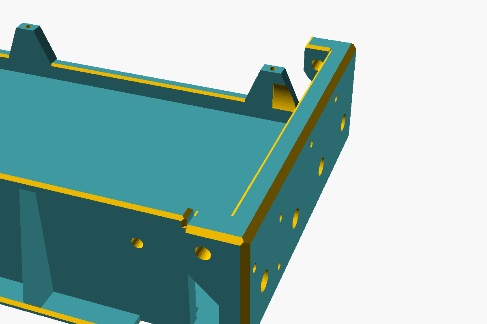

# Printed parts (CAD)

Parametric OpenSCAD models of every printed part, with STLs ready to slice.

- `paint_roller.scad`: all parts in one file. Parameters (bearing type, fits, bottle size) are at the top.
- `assembly.scad`: the whole stack for checking fits. Set `levels` (1 to 3) and `phi` (crank angle) at the top.
- `export.sh`: re-exports every STL into `stl/` after you change a parameter.
- `stl/`: the STLs, already turned onto the bed in their print orientation.

## Designed for FDM

Revision 2 reworked every part for 3D printing rather than as stamped plate:

- **Guard rails** are a thick U channel (7 mm flanges, 8 mm back, chamfered outer corners). Segments stack on a solid 14 × 8 × 10 mm tongue held by one M3 × 30 cross bolt, replacing the 2.6 mm tenon.
- **Lifter bars** are 14 × 12 mm (were 12 × 9.5), so each half of the lap joint is 6 mm thick.
- **Base shell** has 4 mm walls, A-frame crank towers with a wide foot, a 6 mm rock-motor plate with three gussets, and a tapered endstop post.
- **Deck** has a 5 mm front lip, a filleted back wall with a stiffening bead on top and three buttresses behind it, and flared posts under the stop bars. The stop bars are 8 × 12 mm solid bars.
- **End plates** have gussets under the deck-pin bosses.
- **Crank arms** are a solid 12 mm lobe, and the home flag is part of that lobe instead of a thin fin.
- **Motor bracket** is one box-section part with 6 mm walls. The belt guard has 3 mm walls on a 6 mm mounting block.
- **Lid frame** is an 8 mm ring with solid corner blocks.

To fit the thicker rails and lifters, the base is now 160 mm deep (was 152).

## Fewer parts (revision 3)

Revision 3 merges parts that only existed because they were small or bolted together, sized for a 256 × 256 × 256 mm bed (Bambu X1C). The largest parts are the base shell and lid (250 × 160 mm) and the deck (244 × 123 mm). The deck and base already needed a 256 mm bed, so a 220 mm Ender 3 bed won't fit this design.

| Merged part | Replaces | Saved |
| --- | --- | --- |
| `deck` | `deck_frame` + `end_plate_drive` + `end_plate_cap` | 2 parts and 6 M3 screws per level |
| `roller_drive` | `drive_collar` + one `roller_core` | 4 parts per level |
| `roller_cap` | `end_collar` + one `roller_core` | 4 parts per level |
| `yoke_lifter_cap`, `yoke_lifter_drive` | 2 × `yoke_beam` + 4 level-1 lifters | 4 parts and 8 M3 screws |
| `base_shell` | `base_shell` + `front_panel` | 1 part and 4 M3 screws |

| Stack | Parts before | Parts now |
| --- | --- | --- |
| Base + 1 level | 40 | 25 |
| Base + 2 levels | 71 | 46 |
| Base + 3 levels | 102 | 67 |

Unique STLs go from 25 to 20 (counting `fit_test`). The motion is unchanged: the same lifters, cranks and deck pins, and every level is still identical.

How the merged parts print without supports:

- **Deck:** the end plates now stand upright at each end of the tray. The deck-pin bosses have 45° undersides: a 3.5 mm strip on the outside slopes down to the end plate, and the rest of the boss slopes up from that strip. The roller bearing seats are now sideways holes, so check them with the new sideways seats on `fit_test`.
- **Rollers:** each one stands on the plain core end with the collar on top. A 45° cone under the drive collar's flange replaces the flat step. That cone takes 3.5 mm of core, so cut the silicone sleeves 195 mm long.
- **Yoke + lifters:** a flat U, 140 × 133 mm and 15 mm thick, printed lying on its outer face. An 8 mm fillet joins each lifter to the beam. It drops into the base through the same lid slots as before.
- **Base shell:** the OLED window, encoder and MIX button holes are cut into the 4 mm front wall. Mount the parts from inside.

**Kept separate on purpose:**

- **Stop bars** stay as separate parts, so you can reprint them for a different bottle length without reprinting the deck. The 26 × 92 mm bottle size is still a guess.
- **Rail segments** stay separate. Fixing the first rails to the base lid would block the deck-pin bolts during assembly.
- **Motor bracket and belt guard** stay separate, because they print in different orientations and the bracket only goes on level 1.
- **Each roller stays in two pieces**, because a single 227 mm, 12 mm-wide roller standing on end would wobble as it printed.

This revision also fixes a clash from revision 2: roller 1's drive collar ran 0.5 mm into the front lip. The lip now has a 21 mm clearance groove there.

**This CAD hasn't been test printed.** Print `fit_test.stl` first, set the fit parameters from it, and re-export before printing the big parts.

## Chamfered edges (revision 4)

Revision 4 breaks the outer edges with 45° chamfers. Nothing that mates, slides or holds a bearing was changed, and every part keeps its size and print orientation.

- **Every part** gets a 0.4 mm, 45° elephant-foot relief round its bed face (two 0.2 mm layers, from `bed_chamfer()` in `print_part`). Holes that open onto the bed get the same small lead-in. Keep the slicer's own elephant-foot compensation low (0 to 0.1 mm) so the two don't add up.
- **Base shell:** 1.5 mm chamfer round the bottom, 1 mm round the top. **Base lid:** 1 mm round the bottom, 2 mm round the top. The two 1 mm chamfers make a small V reveal at the seam, which hides any mismatch. The lid's crank, yoke and lifter slots have a 1 mm lead-in on top, so the yoke U drops in more easily.
- **Stacking tongues** (on the lid and on every rail) have a 0.8 mm lead-in round the top, so the next rail starts on more easily.
- **Rails:** 1 mm chamfers on the outer tips of both flanges. The back already had 2 mm chamfers.
- **Lifters** (and the lifters on the yoke U): 1 mm chamfers on the four long edges. This also clears the inside corners of the rail channel. The lap faces stay sharp.
- **Yoke beam:** 1 mm on all edges.
- **Crank arms:** 1 mm on both faces of the lobe. The race boss stays sharp because it bears on the bearing's inner race.
- **Deck:** 2 mm on the top outer edges and outer corners of both end plates, 1.5 mm on the outer top of the pin bosses, 1 mm on the inner top edges, the back wall and bead, the front lip top (between the stop-bar posts) and round the bed edge. The bearing seats, pin bores, the stop-bar post tops and the -X end plate face where the bracket and belt guard bolt on stay sharp. The back wall now runs into the pin bosses; before, it stopped 0.5 mm short and left a thin slit at each end.
- **Stop bars:** 1 mm on the top edges and the front corners. The back end, which butts the back wall, stays square.
- **Motor bracket:** 1.5 mm on the motor plate, side web, top arm and mount plate edges. The faces against the motor and the end plate stay flat.
- **Belt guard:** 1 mm on its outer corners and top edges.
- **Lid frame:** 1 mm round the bottom, 1.5 mm round the top, and the corner blocks are rounded to match the ring.

Not chamfered: the rollers (their ends were already chamfered 0.5 mm), the GT2 pulleys and `fit_test`, which only gets the bed relief so it still measures what the real parts will be.

This revision also closes a gap in the `roller_drive` mesh, where the cone under the collar flange met the flange on the same plane. It was 194 loose pieces before and is now one solid.

## Print list

PETG, 0.4 mm nozzle, 0.2 mm layers, 4 walls, 25 % gyroid unless noted. Every part fits a 256 × 256 mm bed (the largest is the 250 × 160 mm base shell). No part needs supports.

### Base kit (print once)

| STL | Qty | Notes |
| --- | --- | --- |
| `fit_test` | 1 | Print first. Bearing seats at −0.1/0/+0.1/+0.2 mm (1 to 4 notches), 5.0 to 5.3 mm rod holes, M4 and M3 holes, an M3 nut trap, and a short rail with a lifter stub to check the sliding fit |
| `base_shell` | 1 | Floor down. Crank towers, rock-motor plate, PCB standoffs, endstop post, and the OLED, encoder and MIX button holes in the front wall |
| `base_lid` | 1 | Flat, rail tongues up. Holds the four guard rails |
| `crank_arm_cap` | 1 | +X arm with the home flag. 100 % infill |
| `crank_arm_drive` | 1 | −X arm. 100 % infill |
| `yoke_lifter_cap` | 1 | +X yoke beam with both level 1 lifters (108.5 mm, carry the caps-up bias). Lies flat on its outer face. 6 walls |
| `yoke_lifter_drive` | 1 | −X yoke beam with both level 1 lifters (97 mm). 6 walls |
| `pulley_60T` | 1 | Rock reduction pulley, 0.12 mm layers |
| `rail_L1` | 4 | First guard-rail segment (104 mm), standing upright on its 28 × 20 mm footprint |
| `lid_frame` | 1 | Sits on the top rail tongues |
| `motor_bracket` | 1 | Roll motor on the level 1 deck. Prints top face down |

### Per level (print once for each level)

| STL | Qty | Notes |
| --- | --- | --- |
| `deck` | 1 | Tray side down, 244 × 123 mm. End plates included: −X has round deck-pin holes, +X has slotted ones and the domed bottle stops |
| `stop_bar_drive` | 1 | Drive-end bottle stop |
| `stop_bar_centre` | 1 | Centre stop between the two bottles in each valley |
| `roller_drive` | 4 | Drive half of each roller: 12 mm core with the O-ring groove collar (G1, G2, M3 grub). 118.5 mm, standing on the core end. Use a brim |
| `roller_cap` | 4 | Cap half of each roller: 12 mm core with the end spacer. 108.5 mm, standing on the core end. Use a brim |
| `double_pulley` | 1 | GT2 20T × 2 on roller 2 (V1 and V2), 0.12 mm layers |
| `belt_guard` | 1 | Levels 1 and 2 only (not the top level) |

### Extra parts for levels 2 and 3

| STL | Qty | Notes |
| --- | --- | --- |
| `rail` | 4 | 90 mm guard-rail segment |
| `lifter` | 4 | 90 mm lifter segment with a lap joint and slotted holes for belt tension. 6 walls |

## Hardware the printed parts need

| Item | Where | Qty |
| --- | --- | --- |
| 5 mm rod, 240 mm | Rollers 1, 3, 4 | 3 per level |
| 5 mm rod, 270 mm | Roller 2 (carries the double pulley) | 1 per level |
| 5 mm rod, 202 mm | Crankshaft | 1 |
| 625ZZ (or MR105ZZ) | 8 per level, 2 crankshaft, 2 crank pins | |
| M5 × 20 bolt + nut + 2 washers | Crank pins | 2 |
| M4 × 20 SHCS + nut | Deck pins | 4 per level |
| M3 grub screw + nut | Collars, pulleys, crank arms | 4 per level + 1 per level (pulley) + 3 |
| M3 countersunk × 8 to 12 | Lifter laps, lid | 8 per lap joint + 6 |
| M3 × 30 + nut | Rail stacking joints (cross bolts) | 4 per level + 4 |
| M3 × 8 to 16 | Stop bars, bracket, guard, PCB | ~18 |
| M2 × 6 + nut | OLED in the front wall | 4 |
| GT2 6 mm closed loop, 158 mm | Rock drive (motor 20T to 60T) | 1 |
| GT2 6 mm closed loop, 158 mm | Roll motor 20T to roller 2 (level 1) | 1 |
| GT2 6 mm closed loop, 220 mm | Roller 2 to roller 2 between levels | 1 per added level |
| Silicone tube 12 × 16 mm, 195 mm | Roller sleeves | 4 per level |
| NBR O-ring 28 × 3 mm | Roller chain | 3 per level |

## What changed from the design doc

Turning the concept into parts moved some numbers. Everything is a parameter, so these can be changed back.

- **Base is 250 × 160 × 62 mm** (was 260 × 152 × 55). 250 mm fits the X1C bed in one piece. The extra height fits the crank, which needs 38 mm of stroke plus a 24 mm Scotch-yoke beam. The yoke beams rise a few mm through slots in the base lid at the top of their stroke.
- **Rock clearance is 32 mm** (was 20). With the 3° caps-up bias and the deck ends reaching past the lifters, the −X end of level 1 drops about 30 mm at the bottom of its stroke, not 19. Heights to the top of the lid frame are now about 178 / 268 / 358 mm for 1 / 2 / 3 levels.
- **The caps-up bias is split ±5.8 mm** (the +X lifters are 11.5 mm longer than the −X ones). The doc's "+X pair 5.8 mm longer" gives only 1.5°; this gives the intended 3°.
- **Deck is 244 mm long** (was 228) so two 92 mm bottles, the drive collars and three domed stops fit with about 3.7 mm spare per bottle. It still fits the bed.
- **The roll motor drives roller 2 through a GT2 158 mm loop** instead of a shaft coupler. The coupler, the V1 pulley and the motor shaft didn't fit in line. The belt version is shorter and uses the second Ender 20T pulley and a $1 belt. Overall length with the motor is about 320 mm.
- **The two GT2 20T pulleys on roller 2 are one printed part** (`double_pulley`), saving about $2 per level. Two bought pulleys still work on a longer roller 2 rod.
- **The rock drive uses a GT2 158 mm loop** (was 200) so the rock motor fits inside the base, and the crankshaft is 5 mm rod in 625ZZ, matching the low-cost BOM (the assembly steps still said 8 mm / 608ZZ).
- **The deck pins sit 32 mm above the deck floor**, above the rollers, in bosses on the end plates.

## Assembly notes

- The crank arms are set exactly 180° apart with their grub screws. File a small flat on the shaft for each grub.
- Lifter segments overlap by 20 mm. The upper segment has slotted holes: slide it up until the GT2 belt between levels is snug, then tighten the countersunk M3s.
- Rails stack with a tongue in a notch and one M3 × 30 bolt across each joint. The lid frame just sits on the top tongues.
- Fit the rollers before the stop bars. Press the 8 bearings into the end-plate seats from inside the tray, sleeve the cores, lay each roller's two halves in place (drive half at −X), then push the rod in from outside through the −X bearing, both halves and the +X bearing. Tighten the collar grub, then screw on the stop bars.
- The yoke + lifter U drops in from above through the lid slots. Fit the crank-pin bearing in its slot and push the M5 bolt through the crank arm.
- The deck pins are M4 bolts locked to the lifter with a nut. They turn freely in the end-plate bosses. The cap-end holes are slots, because the pin spacing changes as the deck tilts.
- Check the endstop post, the DC jack hole (11.2 mm), the USB slot position and the OLED, encoder and button holes against your actual parts before printing the base shell. Their positions are parameters near the top of the base section.
